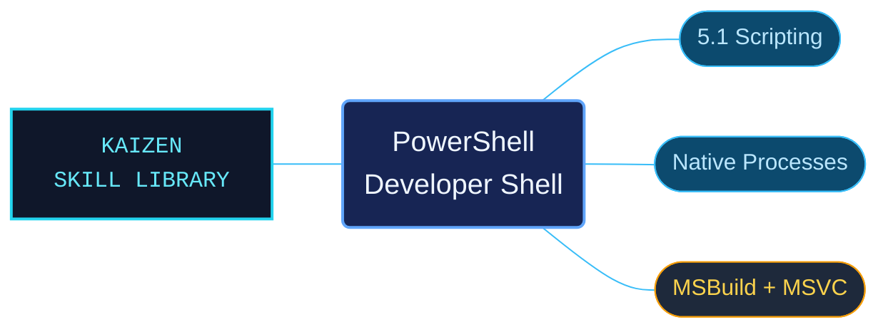

# PowerShell and Visual Studio Developer Shell

A focused reference for Windows PowerShell 5.1 scripting and Visual Studio build workflows, covering native process execution, error handling, text encoding and toolchain setup.

Use when writing, generating, reviewing, or debugging Windows PowerShell 5.1 scripts, setup or build wrappers, native executable invocations, Visual Studio Developer Shell setup, MSBuild or MSVC workflows, Python generation, file paths and encoding, logs, reports, or script validation in a Windows repository.

## What this skill helps with

| Task | Useful reference material |
| --- | --- |
| Write or repair a Windows PowerShell 5.1 wrapper | Supported syntax, data structures, function output and error handling. |
| Run Python or another native tool | Quoting, argument boundaries, exit codes and separate stdout/stderr capture. |
| Prepare a Visual Studio build environment | Installation discovery, Developer Shell initialization and host/target architecture checks. |
| Invoke MSBuild or MSVC | Configuration, platform switches, compiler discovery and toolchain diagnostics. |
| Generate scripts, logs or reports | Literal paths, encoding, BOM handling and values passed between languages. |
| Check a proposed change | Parsing with the intended PowerShell engine, bounded smoke checks and output inspection. |

## The work behind the references

The material has been interpreted and organized into task-focused references with descriptive filenames, explicit loading conditions and linked prerequisites. References retain distinctions that matter in automation, including native exit codes versus PowerShell errors, child-process environments versus the calling shell, and file encoding versus console output. Each reference stays within 100 physical lines, including code and navigation.

## Start here

Open [SKILL.md](SKILL.md) and follow its Context Router, or browse the [reference index](references/INDEX.md). Keep the complete package in the skill location supported by your agent host.

Examples target Windows PowerShell 5.1 and the relevant installed tools. Substitute repository-specific paths and check the documented prerequisites before running them. This is focused scripting and build-wrapper guidance, not a complete PowerShell language or Visual Studio reference. Bundled references are English; [Reference Language Selection](references/languages.md) explains the fallback for other languages.

## Sources and license

Skill reference documentation is interpreted content for use in open source projects. Check against [official documentation sources](https://learn.microsoft.com/en-us/powershell/) when dealing with defects or issues that may come up from interpreting this skill's references.

Licensed under **Apache-2.0**; see [LICENSE](LICENSE). Part of the [Agent Kaizen](https://github.com/LevyBytes/agent-kaizen) skill library.
